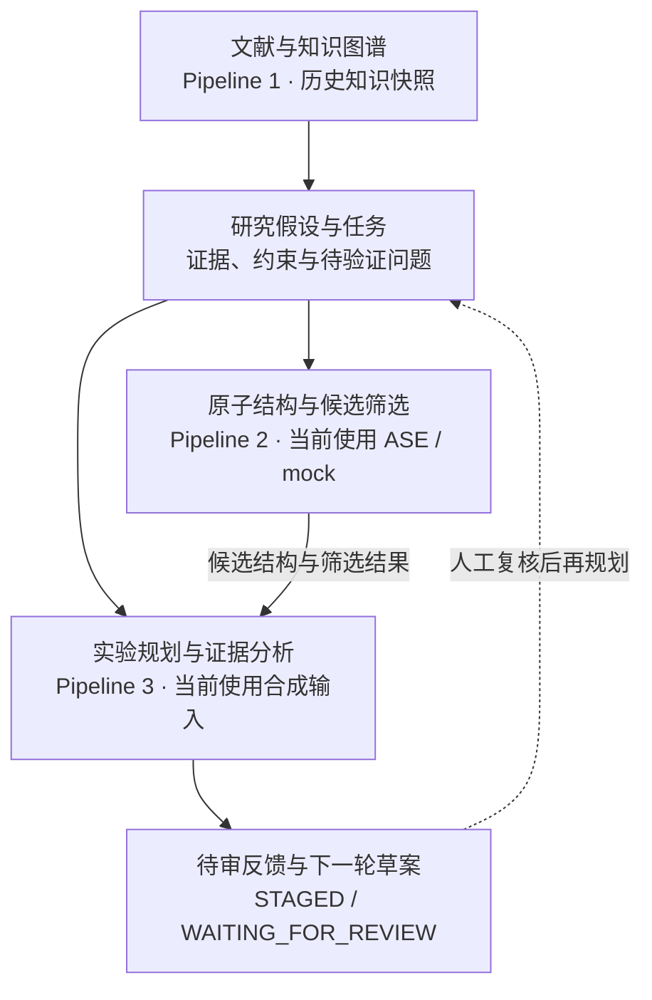
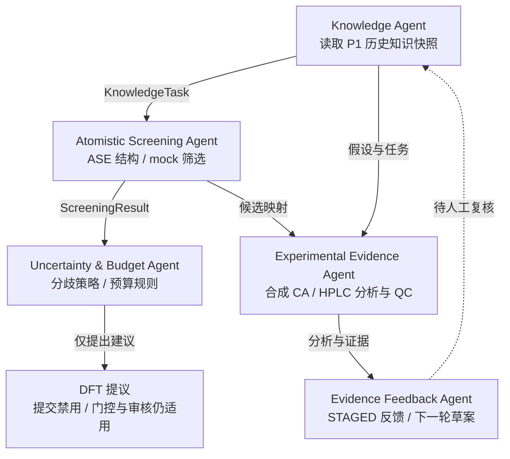
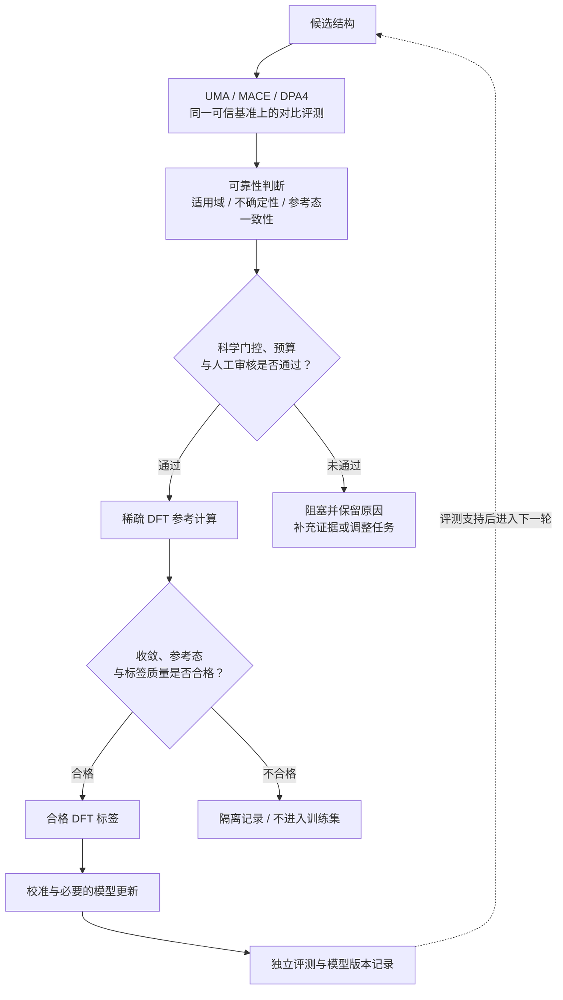

# Ag-X Prediction

**面向 Ag 基催化材料研究，连接文献知识、结构筛选与实验证据的可追溯工作流。**

## [▶ 立即体验在线 Demo](https://agx-prediction-v1-1.streamlit.app/)

**免登录 · 浏览器直接体验 · V1.1 交互演示**

打开后点击 **Start Demo**，按 **Next Step** 查看研究主线。免费应用闲置后可能休眠，请按页面提示唤醒并等待加载。

[快速体验](#三步体验) · [当前实现](#当前实现与技术规划) · [本地运行](#本地运行) · [验收记录](docs/DEPLOYMENT_ACCEPTANCE.md)

## 项目介绍

Ag-X Prediction 围绕 **Ag 基糠醛电氧化催化材料研究**，探索如何将文献中的研究线索转化为结构候选与筛选任务，再结合实验分析形成可复核的下一轮研究建议。技术方案的目标是在科学门控与计算预算约束下，逐步引入基础模型和少量 DFT 参考计算，支持掺杂材料筛选。

当前公开 Demo 展示这条研究链路的软件组织方式：三个独立 Pipeline 通过任务与结果合同连接，每一步保留输入、输出、数据来源、执行记录和文件哈希。评委可以回放固定场景，也可以实际执行新的合成工作流，查看证据如何影响后续建议。

### 总体研究链路



虚线表示需要人工复核的研究建议，不表示已自动放行或正式写回上游。

## 核心功能

| 能力 | 可以体验的内容 |
|---|---|
| 研究流程可视化 | 六个工作区，查看三条 Pipeline 和五个实际执行节点之间的数据传递 |
| Story Mode | 六步讲解主线，逐步查看知识发现、结构生成、筛选策略、实验规划、证据分析与反馈 |
| Agent Inspector | 查看实际工具、上下游合同、执行状态、事件和可校验的原始文件 |
| 五种演示场景 | 基线、模型分歧策略、证据缺失、预测趋势不符与反证，比较不同证据下的处理结果 |
| 合成工作流 | 新建独立 Run，执行 ASE／mock 筛选、合成 CA/HPLC 分析及规则反馈 |
| 待审草案与报告 | 保存、下载下一轮研究草案，下载运行报告和相关证据文件 |

### 当前 Demo 的实际执行流程



这五个 Agent 是**工具编排和规则节点**，当前没有调用真实 LLM。Story Mode 的六个展示步骤映射到这些节点；播放进度不代表现场重新计算。

## 三步体验

1. **打开 [在线 Demo](https://agx-prediction-v1-1.streamlit.app/)**：进入 Workflow Overview，点击 **Start Demo**，使用 **Next Step** 查看主线。窄屏下先展开左上角导航栏。
2. **检查过程与证据**：点击流程节点或 **Open Agent Details**，浏览 Pipeline 1／2／3、Agent Trace 和 Results & Feedback。
3. **切换场景或亲自运行**：在 **Scenario Selector** 选择场景；展开“创建 V1.1 Run”，输入新 Run ID 并执行 **SYNTHETIC** 工作流，再保存草案、下载报告。

| 场景 | 重点观察 |
|---|---|
| `baseline` | 基线流程及待审反馈 |
| `disagreement` | 人工构造的分歧策略如何触发 DFT 提议；不是基础模型的真实预测分歧 |
| `missing` | 证据不完整时保留缺项与不确定结论 |
| `mismatch` | 预测趋势不符时生成复核建议；不将吸附能与电流直接相减 |
| `counter` | 保留反证，重新检查研究假设与替代解释 |

每位访客使用独立临时空间，每会话最多创建 **5 个运行**，实例同时执行一个合成工作流。临时数据可能随会话断开或服务重启清除，请及时下载；公共固定场景保持只读。

## 当前实现与技术规划

| 模块 | 当前可体验 | 后续规划 |
|---|---|---|
| 知识与任务 | 历史文献元数据、知识快照、假设与任务合同 | 结合新证据持续更新研究任务 |
| 原子级筛选 | ASE 结构、解析 mock 测试势、来源明确的候选结果 | UMA／MACE／DPA4 在同一可信基准上的比较与接入 |
| 可靠性与 DFT | 分歧策略、预算规则、待审提议；真实 DFT 为 0 | 经验证的可靠性判断与稀疏 DFT 参考计算 |
| 实验证据 | 合成 CA/HPLC 输入、实际执行的分析与 QC、规则规划 | 真实实验数据验证与符合条件的正式反馈 |
| 模型迭代 | 当前没有真实模型训练 | 使用合格 DFT 标签进行校准、评测和必要的模型更新 |

<details>
<summary><strong>展开技术规划：基础模型与稀疏 DFT 闭环</strong></summary>

**以下是规划能力，当前公开 Demo 尚未接通。**



模型选择由基准证据决定，不预设某个基础模型更优。模型迭代只接受合格标签；CA/HPLC 观察不能直接充当原子级模型的能量／力训练标签。

</details>

### 演示数据与科学边界

- P1 使用经去除论文全文、摘要和本机路径的历史知识派生快照；公开的 `public-v11` 场景是重新执行的 **SYNTHETIC 演示包**。
- P2 使用解析 **mock 测试势**，候选排序不代表经过验证的催化活性；P3 使用合成 CA/HPLC 数据与规则规划。
- 真实基础模型均为 `NOT_CONFIGURED`，选择 `LIVE` 会返回 `BLOCKED`，不会用合成结果替代真实预测。
- 真实 DFT 作业为 **0**，没有启用真实 VASP／PBS 提交或模型训练。反馈保持 `STAGED / WAITING_FOR_REVIEW / PENDING_GATE`，不构成科学验收或正式发布。

## 本地运行

使用 **Python 3.12**：

```bash
python -m venv .venv
source .venv/bin/activate
pip install -r requirements.txt
streamlit run streamlit_app.py
```

本仓库是可独立运行的公开部署包，包含保持独立模块边界的 P2、P3 及演示所需快照，通过现有适配器连接。

<details>
<summary>部署与维护说明</summary>

Streamlit Community Cloud 使用本仓库 `main` 分支，入口为 `streamlit_app.py`，Python 版本为 3.12。无需 API key、模型权重或数据库凭据。功能更新先在 `codex/` 分支验证，再进入部署分支；回滚使用 `git revert` 恢复上一验收版本。

</details>

## 验证与追溯

- [Linux CI 验证记录](https://github.com/TristanClay/agx-prediction-demo/actions)
- [部署验收记录及尚未确认的检查项](docs/DEPLOYMENT_ACCEPTANCE.md)
- [五种场景与原版的对照记录](scenario_comparison.json)
- [公开包来源与转换说明](publication_sources.json)
- [文件 SHA-256 清单](SHA256SUMS)

**软件流程通过测试与数据完整性校验，不等于材料性能或科学结论已获验证。**
